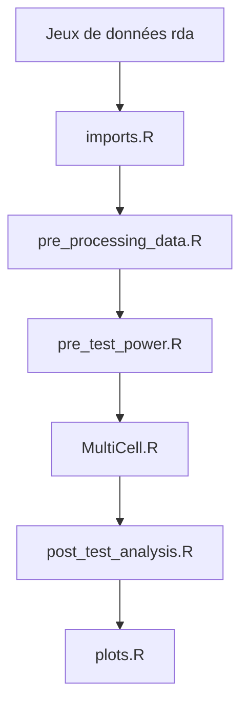

# facebookincubator/GeoLift

> Package R de mesure d'incrémentalité par zone géographique, via la méthode du contrôle synthétique, pour le marketing.

## Le problème
Mesurer l'effet réel d'une campagne publicitaire par région exige de choisir les marchés de test et de contrôler le biais.

## Ce que ça fait vraiment
Sélection de marchés pilotée par les données, calculateurs de puissance statistique, inférence et graphiques pour analyser un test. Un mode multi-cellules et la prise en compte de zones de navettage existent. Le code d'analyse repose sur le paquet augsynth.

## Comment c'est branché


## Essayer
```r
install.packages("remotes", repos='http://cran.us.r-project.org')
remotes::install_github("ebenmichael/augsynth")
remotes::install_github("facebookincubator/GeoLift")
```

## Coût et pièges
Gratuit, R 4.0.0 ou plus, avec augsynth à installer depuis GitHub avant le paquet.

## Ce que ce n'est pas
Pas un outil de modélisation de mix média : il mesure des tests géographiques. Dernier push en juin 2026, donc encore actif.

## Alternatives
Aucune alternative nommée dans le README.

## Pour toi
À surveiller : utile si tu fais de l'inférence causale ou de la mesure marketing, en R.

