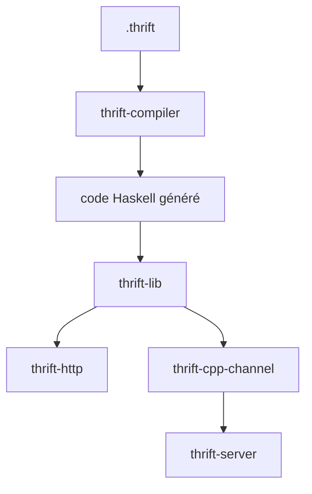

# facebookincubator/hsthrift

> Thrift compiler and libraries for writing RPC clients and servers in Haskell, compatible with fbthrift.

## The problem
Facebook services communicate over Thrift; a Haskell project needs the generator and libraries to talk to them.

## What it actually does
Provides the Haskell Thrift compiler and Cabal packages: mangle, fb-util, folly-clib, thrift-lib, thrift-http, thrift-cpp-channel, thrift-server. Compatible with fbthrift but not with Apache Thrift.

## How it is wired
Simplified diagram based on the fiche, no diagram provided.


## Trying it
```bash
make thrift-cpp
cabal build exe:thrift-compiler
make thrift-hs
cabal test all
```

## Cost and gotchas
Heavy installation: folly, fbthrift, fizz, wangle via `./new_install_deps.sh`, Cabal 3.6+. The README itself considers the system dependency list incomplete. HTTP-only variant available from Hackage.

## What it is not
Not compatible with Apache Thrift; thrift-cpp-channel and thrift-server are not on Hackage.

## Alternatives
fbthrift and Apache Thrift (for different uses).

## For you
Ignore: Haskell RPC, far from data/AI/MLOps work.
