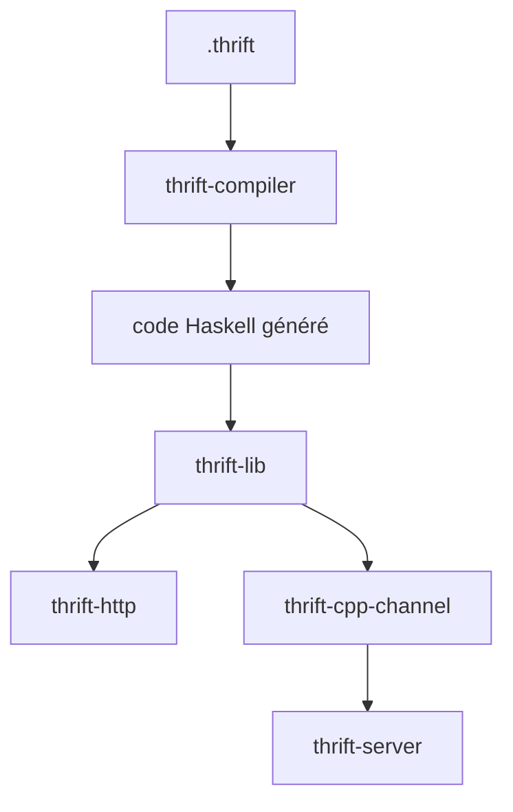

# facebookincubator/hsthrift

> Compilateur et bibliothèques Thrift pour écrire clients et serveurs RPC en Haskell, compatibles fbthrift.

## Le problème
Les services Facebook communiquent en Thrift ; un projet Haskell a besoin du générateur et des bibliothèques pour dialoguer avec eux.

## Ce que ça fait vraiment
Fournit le compilateur Thrift Haskell et des paquets Cabal : mangle, fb-util, folly-clib, thrift-lib, thrift-http, thrift-cpp-channel, thrift-server. Compatible avec fbthrift mais pas avec Apache Thrift.

## Comment c'est branché
Schéma simplifié d'après la fiche, sans diagramme fourni.


## Essayer
```bash
make thrift-cpp
cabal build exe:thrift-compiler
make thrift-hs
cabal test all
```

## Coût et pièges
Installation lourde : folly, fbthrift, fizz, wangle via `./new_install_deps.sh`, Cabal 3.6+. Liste des dépendances système jugée incomplète par le README. Variante HTTP seule depuis Hackage.

## Ce que ce n'est pas
Pas compatible Apache Thrift ; thrift-cpp-channel et thrift-server ne sont pas sur Hackage.

## Alternatives
fbthrift et Apache Thrift (à usage différent).

## Pour toi
À ignorer : RPC Haskell, loin d'un travail data/IA/MLOps.

