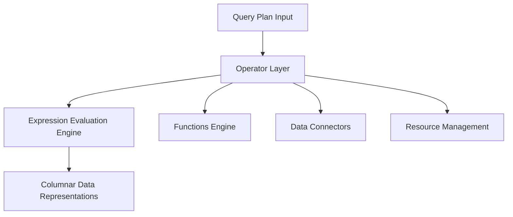

# facebookincubator/velox

> C++ library of query execution components, for those building a data processing engine.

## The problem
Every analytical engine (Presto, Spark and others) rewrites the same operators, functions and file readers. The work is duplicated and unevenly optimized.

## What it actually does
Velox takes an already optimized query plan as input and executes it. It provides a type system, Arrow-compatible columnar vectors, vectorized expression evaluation, functions with Presto and Spark semantics, relational operators, connectors (ORC, Parquet, Nimble; S3, HDFS, GCS, ABFS) and memory management. It has no SQL parser, no dataframe layer, and no optimizer.

## How it is wired


## Trying it
```bash
git clone https://github.com/facebookincubator/velox.git
cd velox
./scripts/setup-ubuntu.sh
make
make unittest
docker-compose build ubuntu-cpp
docker-compose run --rm ubuntu-cpp
```

## Cost and gotchas
Free. Heavy build: the README provides `BUILD_THREADS` to avoid out-of-memory stops. It requires GCC 11 or Clang 15 and, on x86, at least SSE4.2.

## What it is not
Not a database nor an end-user tool. A host engine is needed to supply it with plans. No ready-to-use binary is described.

## Alternatives
No alternative named in the README.

## For you
Worth watching: it is the execution building block behind several data engines, useful to understand if you do low-level data engineering, with no direct use.
