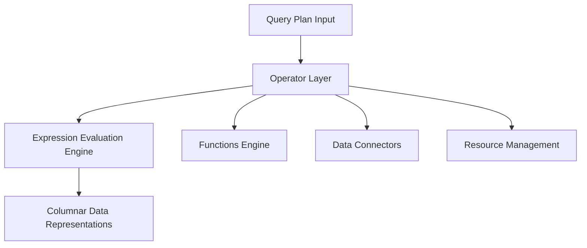

# facebookincubator/velox

> Bibliothèque C++ de composants d'exécution de requêtes, pour qui construit un moteur de traitement de données.

## Le problème
Chaque moteur analytique (Presto, Spark et autres) réécrit les mêmes opérateurs, fonctions et lecteurs de fichiers. Le travail est dupliqué et inégalement optimisé.

## Ce que ça fait vraiment
Velox prend en entrée un plan de requête déjà optimisé et l'exécute. Il fournit un système de types, des vecteurs en colonnes compatibles Arrow, l'évaluation vectorisée d'expressions, des fonctions aux sémantiques Presto et Spark, des opérateurs relationnels, des connecteurs (ORC, Parquet, Nimble ; S3, HDFS, GCS, ABFS) et la gestion de mémoire. Il n'a ni analyseur SQL, ni couche dataframe, ni optimiseur.

## Comment c'est branché


## Essayer
```bash
git clone https://github.com/facebookincubator/velox.git
cd velox
./scripts/setup-ubuntu.sh
make
make unittest
docker-compose build ubuntu-cpp
docker-compose run --rm ubuntu-cpp
```

## Coût et pièges
Gratuit. Compilation lourde : le README prévoit `BUILD_THREADS` pour éviter les arrêts par manque de mémoire. Il exige GCC 11 ou Clang 15 et, sur x86, au moins SSE4.2.

## Ce que ce n'est pas
Ce n'est pas une base de données ni un outil pour utilisateur final. Il faut un moteur hôte qui lui fournisse les plans. Aucun binaire prêt à l'emploi n'est décrit.

## Alternatives
Aucune alternative nommée dans le README.

## Pour toi
À surveiller : c'est la brique d'exécution derrière plusieurs moteurs de données, utile à comprendre si tu fais de l'ingénierie data bas niveau, sans usage direct.

