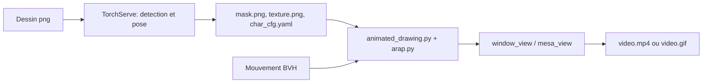

# facebookresearch/AnimatedDrawings

> Animates children's drawings of human figures from motion capture data, for researchers and creatives.

## The problem
Bringing a hand drawing to life requires annotating skeleton and mask, then rigging it, which is tedious work.

## What it actually does
Implementation of a research paper's algorithm. A silhouette detector and a pose estimator served by TorchServe produce the mask, texture and character configuration file. The drawing is deformed with the ARAP method from motions in BVH format, then rendered in a window, as MP4 or as a transparent GIF. A web interface lets you fix misplaced joints.

## How it is wired


## Trying it
```bash
conda create --name animated_drawings python=3.8.13
conda activate animated_drawings
git clone https://github.com/facebookresearch/AnimatedDrawings.git
cd AnimatedDrawings
pip install -e .
```
Then, in Python: `render.start('./examples/config/mvc/interactive_window_example.yaml')`.

## Cost and gotchas
Python 3.8.13 pinned, tested on macOS Ventura and Ubuntu 18.04. The TorchServe container may require 16 GB of RAM; its image takes 5 to 7 minutes to build. The dataset is about 50 GB.

## What it is not
Archived repository: no more fixes. The pose model assumes a human body with two arms and two legs; other skeletons are configured by hand.

## Alternatives
No alternative named in the README. A web demo is given to avoid installation (sketch.metademolab.com).

## For you
Ignore for actual use: archived and tied to Python 3.8. The Amateur Drawings dataset and the MIT weights may remain useful for a vision project.
