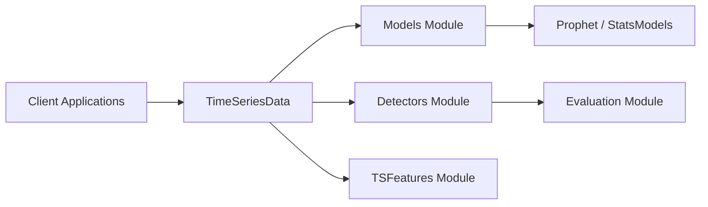

# facebookresearch/Kats

> Python toolkit for time series analysis: forecasting, detection, feature extraction.

## The problem
Time series analyses scatter forecasting, anomaly detection and features across several libraries with different APIs.

## What it actually does
A common `TimeSeriesData` object on top of pandas.
Forecasting (Prophet, ARIMA, global neural model, ensembles, meta-learning for hyperparameters).
Change-point and anomaly detection (CUSUM, StatSig, DTW…), with evaluators and simulators.
`TsFeatures` to extract features; minimal installation possible.

## How it is wired


## Trying it
```bash
pip install --upgrade pip
pip install kats
MINIMAL_KATS=1 pip install kats
```

## Cost and gotchas
Free, MIT. Many heavy dependencies (Prophet…); minimal mode disables some features.
Changelog in the README stops at 0.2.0.

## What it is not
Not a real-time monitoring tool.
Not a recent deep learning framework for time series.

## Alternatives
No alternative named in the README.

## For you
Worth watching: handy for change-point detection and features, but check dependency compatibility before making it a pillar.
