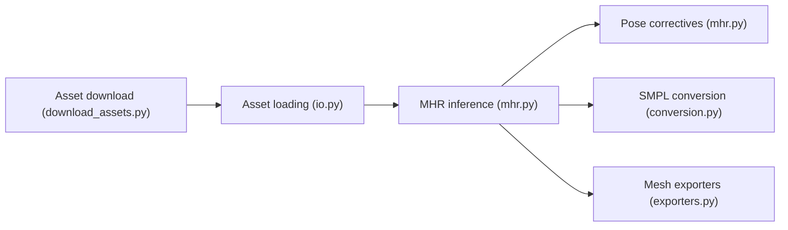

# facebookresearch/MHR

> Parametric 3D human body model in PyTorch, with identity, pose and facial expressions, for research.

## The problem
You need a differentiable human body model, with face and hands, to estimate or optimize poses.

## What it actually does
From 45 identity parameters, 204 pose parameters and 72 expression parameters, returns the mesh vertices and the skeleton state. 7 levels of detail, neural-network pose correctives, PyTorch gradients, conversion to SMPL/SMPL-X, web viewer. The model assets are downloaded separately.

## How it is wired


## Trying it
```bash
pixi install
pixi run download-assets
pixi shell
python demo.py
pip install mhr
mhr-download-assets --member assets/mhr_model.pt --output mhr_model.pt
```

## Cost and gotchas
Python ≥ 3.11 and pymomentum ≥ 0.1.90; the pip install is marked experimental, Pixi is recommended. The TorchScript model only handles LOD 1.

## What it is not
Not a tool for estimating pose from images: the README points to Sam3D for that.

## Alternatives
SMPL/SMPL-X (conversion provided), Sam3D for inference from images.

## For you
Worth watching: relevant if you do 3D vision or motion capture; unrelated otherwise.
