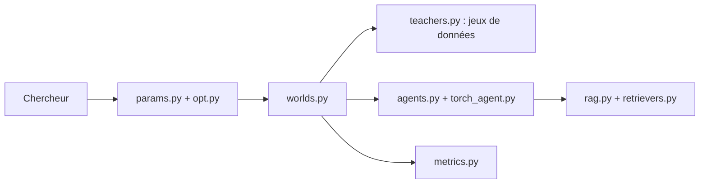

# facebookresearch/ParlAI

> Python framework to train and evaluate dialogue models on more than 100 datasets.

## The problem
Comparing dialogue models requires heterogeneous datasets and distinct evaluation protocols.

## What it actually does
Provides a common API for more than 100 datasets (PersonaChat, SQuAD, etc.), reference and pretrained models, training and evaluation scripts, as well as Amazon Mechanical Turk and Facebook Messenger integration. Data is downloaded to `~/ParlAI/data`.

## How it is wired


## Trying it
```bash
python3.8 -m venv venv
venv/bin/pip install parlai
parlai display_data -t squad
parlai eval_model -m ir_baseline -t personachat -dt valid
```

## Cost and gotchas
Free. Python 3.8+, PyTorch 1.6+, Windows not supported. Installing from source may fail on PyTorch.

## What it is not
The repository is archived: no more fixes to expect. It predates modern LLMs and does not cover them.

## Alternatives
- No alternative named in the README.

## For you
Ignore: archived and predates current LLMs; only to consult for old dialogue datasets.
