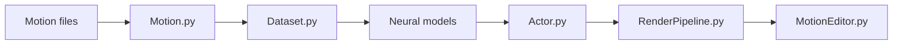

# facebookresearch/ai4animationpy

> A Python framework for neural-network character animation, with built-in mocap processing and rendering.

## The problem
AI-driven animation research required Unity for visualization and ONNX bridges with PyTorch.

## What it actually does
All in NumPy/PyTorch: ECS architecture with an update loop, GLB/FBX/BVH import to an `.npz` format, MLPs, autoencoders and Codebook Matching with training utilities, FABRIK inverse kinematics, real-time rendering (shadows, SSAO, bloom), three modes: Standalone, Headless and Manual. Backpropagation through inference is possible. Physics, audio and path planning are announced as "coming soon".

## How it is wired


## Trying it
```python
from ai4animation import Motion
motion = Motion.LoadFromGLB("character.glb")
motion.SaveToNPZ("character")
```
```bash
convert --input_dir path/to/motions --output_dir path/to/output
```

## Cost and gotchas
Free. The announced gains (data generation ~4 h versus more) come from the author. License present but not identified by GitHub.

## What it is not
Not a complete game engine: physics and audio are not there yet.

## Alternatives
AI4Animation (Unity version): older, depends on Unity and ONNX.

## For you
Worth watching: relevant for animation or mocap research, too specialized otherwise; clarify the license before use.
