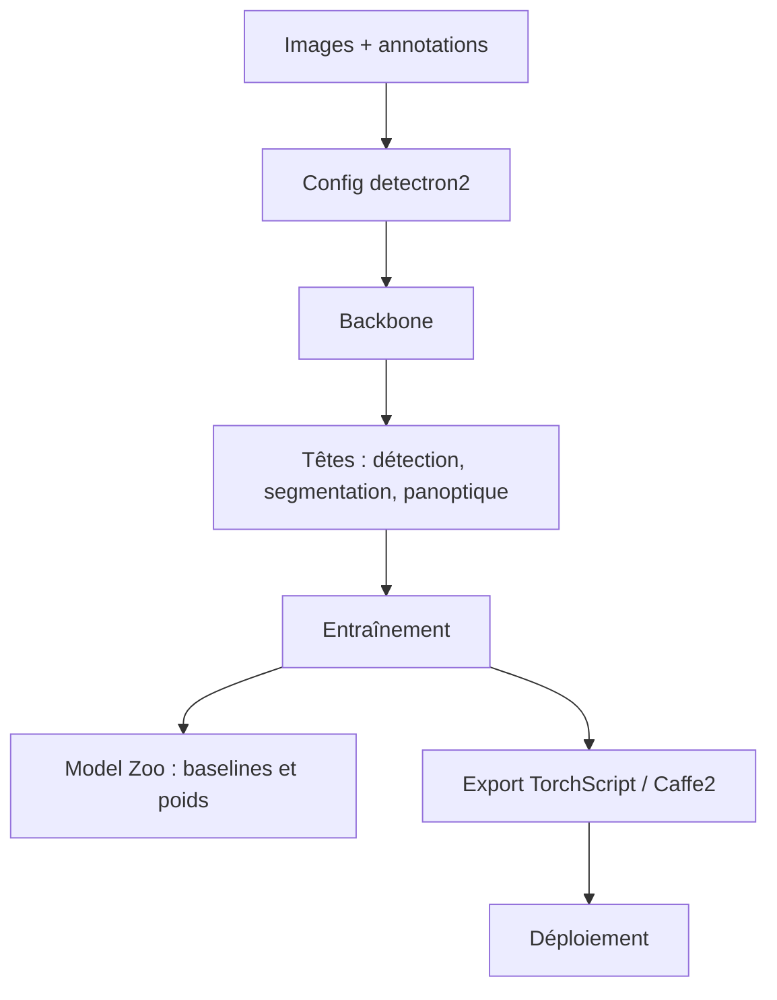

# facebookresearch/detectron2

> Facebook AI Research's image detection and segmentation library, successor to Detectron.

## The problem
Reimplementing a correct detection or segmentation head costs weeks and compares poorly with the literature.
Without trained reference models, there is no way to know whether your baseline is right.

## What it actually does
Provides detection and segmentation algorithms: panoptic segmentation, DensePose, Cascade R-CNN, rotated boxes, PointRend, DeepLab, ViTDet, MViTv2.
Used as a library, to build research projects on top of it; the `projects/` folder gives examples.
Models can be exported to TorchScript or Caffe2 format for deployment.
A Model Zoo publishes a large set of baseline results and trained models to download.

## How it is wired

## Trying it
No command is present in the README: it points to the "installation instructions", the "Getting Started" guide and a Colab notebook. Not documented.

## Cost and gotchas
Free; the real cost is the training GPU and annotation time.
Deliberately short README: all the useful documentation is outside the repository, to be followed through links.

## What it is not
It is not a turnkey tool: it is a research library to integrate into your own code.
It is not a recent project: the BibTeX entry dates from 2019 and the README mentions no later evolution.
It is not end-to-end oriented toward modern transformers, despite ViTDet and MViTv2.

## Alternatives
- Detectron — the predecessor, cited; of no interest today.
- maskrcnn-benchmark — also replaced by detectron2 according to the README.

## For you
Pull it out only to reproduce a classic vision baseline; otherwise, the ecosystem has moved elsewhere.
