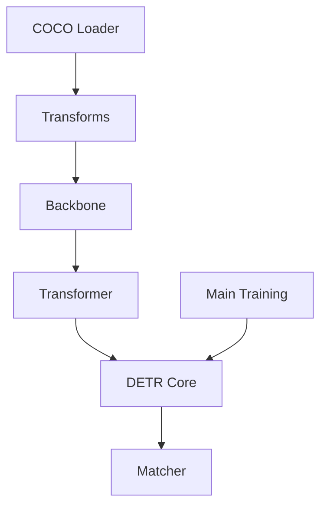

# facebookresearch/detr

> Training code and pretrained models for DETR, transformer-based object detection. It is archived.

## The problem
Classic detectors rely on hand-tuned anchors and an NMS step, which are heavy to maintain.

## What it actually does
DETR treats detection as set prediction: a global bipartite-matching loss, a transformer encoder-decoder and learned object queries.
R50 and R101 models (with DC5 variants), from 42 to 44.9 AP on COCO, and a panoptic version.
Loading via `torch.hub`, training with `main.py`, multi-node with submitit, and a Detectron2 wrapper (`d2/`).

## How it is wired


## Trying it
```bash
git clone https://github.com/facebookresearch/detr.git
conda install -c pytorch pytorch torchvision
conda install cython scipy
python -m torch.distributed.launch --nproc_per_node=8 --use_env main.py --coco_path /path/to/coco
python main.py --batch_size 2 --no_aux_loss --eval --resume https://dl.fbaipublicfiles.com/detr/detr-r50-e632da11.pth --coco_path /path/to/coco
```

## Cost and gotchas
Training 300 epochs takes about 6 days on 8 V100s. The project is archived and no longer maintained.

## What it is not
It is not the current state of the art. It is not a library: the README says so, it is a plain `main.py`.

## Alternatives
- Detectron2: the README provides a wrapper to integrate with it.

## For you
Ignore it as a tool: it is archived. It remains a reference read if you work in vision.
