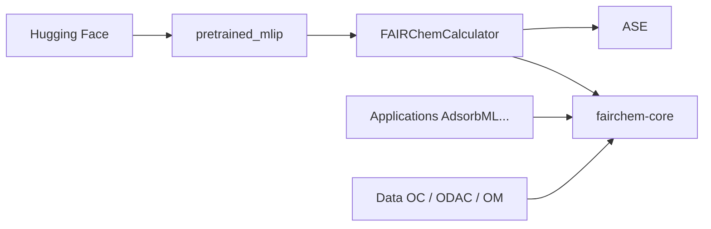

# facebookresearch/fairchem

> FAIR Chemistry repository: UMA models, data and tools for quantum chemistry and materials.

## The problem
Computing energies and forces of atoms by DFT is very expensive; a general learned potential speeds up relaxations and molecular dynamics.

## What it actually does
The `fairchem-core` package provides the pretrained UMA models (uma-s, uma-m), usable through an ASE calculator `FAIRChemCalculator` with one task per domain (oc20, omat, omol, odac, omc…). It handles relaxations, molecular dynamics, spin gap and multi-GPU inference (Ray). The monorepo also contains applications (AdsorbML, cattsunami, ocx), data modules and configs.

## How it is wired


## Trying it
```bash
pip install fairchem-core
huggingface-cli login
```
```python
from fairchem.core import pretrained_mlip, FAIRChemCalculator
predictor = pretrained_mlip.get_predict_unit("uma-s-1p2p1", device="cuda")
calc = FAIRChemCalculator(predictor, task_name="oc20")
```

## Cost and gotchas
Hugging Face account with access requested to the UMA repository. A CUDA GPU for realistic use. The OMat24 models are not compatible with the Materials Project corrections (do not mix them).

## What it is not
Not DFT software: it approximates learned calculations. License present but not identified by GitHub, to be checked, notably for the weights.

## Alternatives
- No alternative named in the README.

## For you
Keep an eye on it: very useful in materials science, outside your field otherwise; check the license before any use.
