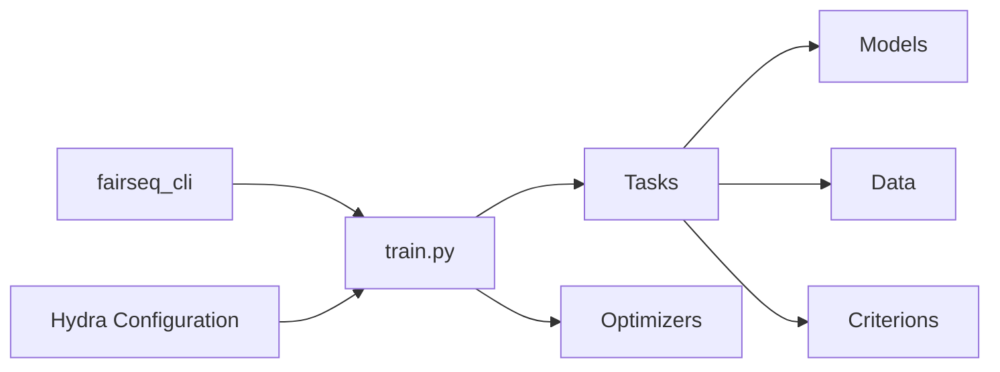

# facebookresearch/fairseq

> Meta's PyTorch sequence-modeling toolkit, archived, for NLP and speech research.

## The problem
Reproducing translation, language-model or speech papers required reference implementations trainable at large scale.

## What it actually does
Reference implementations: Transformer, RoBERTa, BART, mBART, XLM-R, wav2vec 2.0, non-autoregressive models, etc.
Multi-GPU/multi-node training, mixed precision, parameter sharding, CPU offload.
Generation by beam search, sampling, constrained decoding; Hydra configuration.
Pre-trained models via `torch.hub`.

## How it is wired


## Trying it
```bash
git clone https://github.com/pytorch/fairseq
cd fairseq
pip install --editable ./
```

## Cost and gotchas
NVIDIA GPU and NCCL to train. Archived repository: no more fixes.

## What it is not
No longer maintained; not a base for a new project. Not easy to approach outside research.

## Alternatives
- NVIDIA apex: cited as a complement to speed up training, not a replacement.

## For you
Consult it to reproduce an old paper; otherwise pass.
