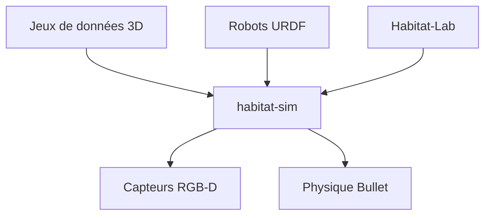

# facebookresearch/habitat-sim

> Fast 3D simulator with physics for training embodied AI agents in indoor scenes.

## The problem
Training navigation or manipulation agents requires millions of simulated frames, which general-purpose simulators produce too slowly.

## What it actually does
Habitat-Sim loads 3D scans (HM3D, Matterport3D, Gibson, Replica) and CAD models, simulates RGB-D sensors and URDF robots, with Bullet physics. The README claims several thousand frames per second on a single thread. It is used with Habitat-Lab to define tasks and train agents.

## How it is wired
Simplified diagram based on the write-up, no diagram provided.


## Trying it
```bash
conda create -n habitat python=3.12 cmake=3.27
conda activate habitat
conda install habitat-sim withbullet -c conda-forge -c aihabitat
python -m habitat_sim.utils.datasets_download --uids habitat_test_scenes --data-path /path/to/data/
```

## Cost and gotchas
Free. Python 3.9+ and cmake 3.22+ required; a headless variant exists for multi-GPU servers. Datasets are downloaded separately. Meta no longer provides maintenance beyond v0.3.4.

## What it is not
It is not a project actively maintained by Meta: the repository is archived and only suggests forking. It is not a general-purpose rendering engine; speed takes priority over breadth of simulation.

## Alternatives
No alternative named in the README.

## For you
Worth watching: an embodied AI reference useful in research, but frozen at v0.3.4, so reserve it for work that already builds on Habitat.
