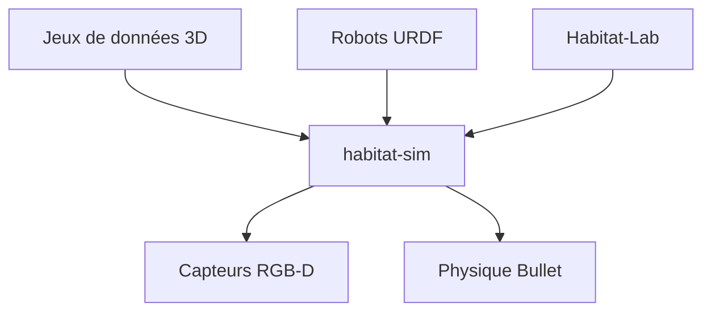

# facebookresearch/habitat-sim

> Simulateur 3D rapide avec physique pour entraîner des agents d'IA incarnée dans des scènes d'intérieur.

## Le problème
Entraîner des agents de navigation ou de manipulation demande des millions d'images simulées, que les simulateurs généralistes produisent trop lentement.

## Ce que ça fait vraiment
Habitat-Sim charge des scans 3D (HM3D, Matterport3D, Gibson, Replica) et des modèles CAO, simule des capteurs RGB-D et des robots URDF, avec la physique Bullet. Le README annonce plusieurs milliers d'images par seconde en un seul thread. Il s'utilise avec Habitat-Lab pour définir les tâches et entraîner les agents.

## Comment c'est branché
Schéma simplifié d'après la fiche, sans diagramme fourni.


## Essayer
```bash
conda create -n habitat python=3.12 cmake=3.27
conda activate habitat
conda install habitat-sim withbullet -c conda-forge -c aihabitat
python -m habitat_sim.utils.datasets_download --uids habitat_test_scenes --data-path /path/to/data/
```

## Coût et pièges
Gratuit. Python 3.9+ et cmake 3.22+ requis ; une variante headless existe pour les serveurs multi-GPU. Les jeux de données sont téléchargés à part. Meta n'assure plus de maintenance au-delà de la v0.3.4.

## Ce que ce n'est pas
Ce n'est pas un projet suivi par Meta : le dépôt est archivé et propose seulement de forker. Ce n'est pas un moteur de rendu généraliste, la vitesse prime sur l'étendue des simulations.

## Alternatives
Aucune alternative nommée dans le README.

## Pour toi
À surveiller : référence de l'IA incarnée utile en recherche, mais figée à la v0.3.4, donc à réserver à des travaux qui s'appuient déjà sur Habitat.

