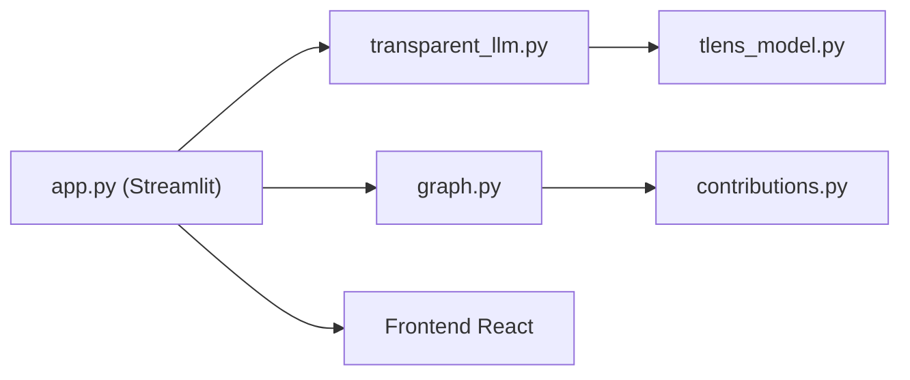

# facebookresearch/llm-transparency-tool

> Streamlit application to inspect the internal contribution graph of an LLM, aimed at interpretability researchers.

## The problem
Understanding which attention heads and FFN blocks influence a token's prediction is hard without visualization.

## What it actually does
Loads a model, runs a prompt, then builds a contribution graph from a chosen token, with an adjustable threshold. You click on edges, attention heads, FFN blocks and neurons to see what is promoted or suppressed, and project a representation onto the output vocabulary. Builds on TransformerLens.

## How it is wired


## Trying it
```bash
docker build -t llm_transparency_tool .
docker run --rm -p 7860:7860 llm_transparency_tool
streamlit run llm_transparency_tool/server/app.py -- config/local.json
```

## Cost and gotchas
Free. Local installation with conda, `pip install -e .` and a frontend build (yarn). Significant memory depending on the chosen model.

## What it is not
Not maintained: archived, last push in December 2024. Not an evaluation or security audit tool, it is manual exploration.

## Alternatives
- TransformerLens: the library it builds on.

## For you
To ignore for everyday use: archived and with no identified license, useful only as a pedagogical reference in interpretability.
