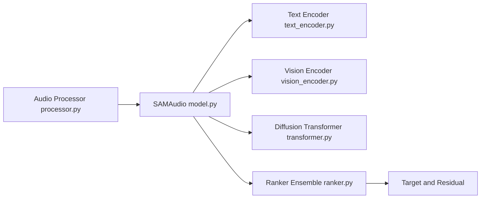

# facebookresearch/sam-audio

> Meta foundation model that isolates a sound in a mixture via text, video or time span.

## The problem
Separating a specific source (voice, instrument, horn) from an audio mixture requires models specialized by sound type.

## What it actually does
`SAMAudio` takes an audio and a prompt (text as a lowercase noun/verb phrase, video mask, or time ranges) and returns an isolated target and a residual. Options: automatic span prediction and reranking of candidates by CLAP, Judge or ImageBind. Small/base/large models and `-tv` variants.

## How it is wired


## Trying it
```bash
pip install .
hf auth login
```
```python
from sam_audio import SAMAudio, SAMAudioProcessor
model = SAMAudio.from_pretrained("facebook/sam-audio-large")
processor = SAMAudioProcessor.from_pretrained("facebook/sam-audio-large")
```

## Cost and gotchas
Python ≥ 3.11 and a CUDA GPU recommended. You must request access to the checkpoints on Hugging Face, then authenticate. `predict_spans` and `reranking_candidates` improve quality but cost latency and memory.

## What it is not
Not a ready-to-use consumer tool: a research library. A license is present but not identified by GitHub: read it before any commercial use.

## Alternatives
No alternative named in the README.

## For you
Worth watching: interesting for multimodal audio processing, but gated access and license to clarify.
