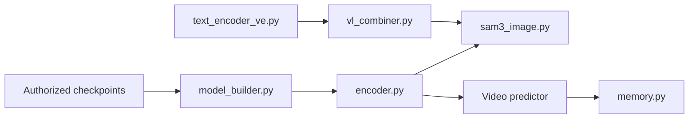

# facebookresearch/sam3

> Image and video segmentation model guided by text or examples, for computer vision.

## The problem
Segmenting "all objects matching a concept" (e.g. "player in white") required a fixed-vocabulary detector or manual clicks.

## What it actually does
A DETR-style detector conditioned on text, geometry or visual examples, and a tracker inherited from SAM 2, sharing one encoder (848 M parameters).
Image API (`Sam3Processor`) returning masks, boxes and scores; session-based video API with prompts on any frame.
SAM 3.1: multiplex tracking of several objects; optional agent coupling an LLM.
SA-Co/Gold, Silver and VEval evaluation sets; training and evaluation code provided.

## How it is wired


## Trying it
```bash
conda create -n sam3 python=3.12
conda activate sam3
pip install torch==2.10.0 torchvision --index-url https://download.pytorch.org/whl/cu128
git clone https://github.com/facebookresearch/sam3.git
cd sam3
pip install -e .
jupyter notebook examples/sam3_image_predictor_example.ipynb
```

## Cost and gotchas
CUDA 12.6+ GPU, Python 3.12, PyTorch 2.7+; access to the checkpoints must be requested on Hugging Face, then `hf auth login`.
License not identified by GitHub: read its clauses before commercial use.

## What it is not
Not usable without a GPU or without access approval for the weights.
Still far from human level on the published video benchmarks.

## Alternatives
No alternative named in the README (OWLv2, DINO-X and Gemini 2.5 are result comparisons, not repositories).

## For you
Adopt it for any open-vocabulary annotation or segmentation need, subject to reading the weights' license.
