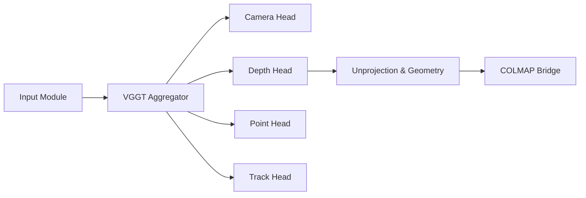

# facebookresearch/vggt

> Feed-forward transformer (CVPR 2025) that infers cameras, depth and point clouds from views.

## The problem
Classic 3D reconstruction (SfM, bundle adjustment) is slow and fragile with few images.

## What it actually does
From one, a few or hundreds of images: camera parameters, depth maps, point maps, 3D point tracking, in seconds.
Separate heads (camera, depth, point, track) on a token aggregator.
VGGT-1B weights downloaded from Hugging Face.
Gradio and Viser demos, COLMAP export compatible with Gaussian Splatting (gsplat).

## How it is wired


## Trying it
```bash
git clone git@github.com:facebookresearch/vggt.git
cd vggt
pip install -r requirements.txt
python demo_gradio.py
python demo_colmap.py --scene_dir=/YOUR/SCENE_DIR/ --use_ba
```

## Cost and gotchas
CUDA GPU recommended; 3D visualization can take tens of seconds. License to be checked before commercial use.

## What it is not
Not a rendering engine: it produces the geometry, rendering goes through gsplat or something else. Smaller variants not released.

## Alternatives
No alternative named as a repository; the README compares monocular results to DepthAnything v2 and MoGe.

## For you
Worth watching if you work on 3D vision: a recent reference model, but the license must be clarified before any product.
