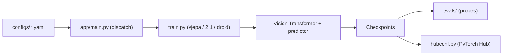

# facebookresearch/vjepa2

> Meta's official code for V-JEPA 2: self-supervised video models and a world model for robotics.

## The problem
Learning video representations without labels, then reusing them to recognize actions, answer questions about video or plan robot movements.

## What it actually does
A Vision Transformer encoder and a predictor learn by predicting masked tokens in latent space. The repository provides training (V-JEPA 2, 2.1, and the action-conditioned V-JEPA 2-AC on DROID trajectories), evaluation with attention probes on a frozen backbone, checkpoints, and a PyTorch Hub / Hugging Face export. Local or SLURM launch goes through `app/main.py` and `evals/main.py`.

## How it is wired


## Trying it
```bash
conda create -n vjepa2-312 python=3.12
conda activate vjepa2-312
pip install .
python -m notebooks.vjepa2_demo
```

## Cost and gotchas
A CUDA GPU is essential; `decord` does not work on macOS. The weights must be downloaded separately (Meta or Hugging Face) and pre-training assumes a SLURM cluster.

## What it is not
Not a ready-to-plug product: it is research code. Robotics requires a Franka robot and DROID data.

## Alternatives
No alternative named in the README.

## For you
Worth watching: the video backbones via PyTorch Hub or Hugging Face are directly reusable for feature extraction; full pre-training exceeds most budgets.
