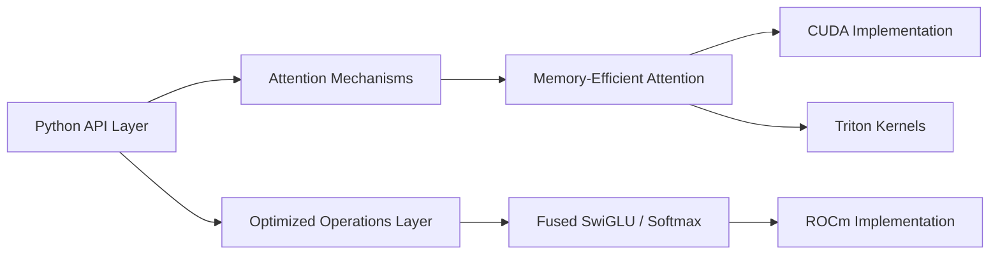

# facebookresearch/xformers

> Optimized Transformer building blocks (memory-efficient attention, fused kernels) for PyTorch on GPU.

## The problem
Standard attention saturates GPU memory and slows down Transformer training and inference.

## What it actually does
`xformers.ops.memory_efficient_attention`: exact attention, advertised as up to 10x faster. Sparse and block-sparse attention, fused softmax, linear, layer norm, dropout and SwiGLU. Own CUDA kernels, with dispatch to Triton, CUTLASS or Flash-Attention when relevant. Pip wheels for CUDA 12.6/12.8/13.0, experimental ROCm; `python -m xformers.info` lists the available kernels.

## How it is wired


## Trying it
```bash
pip3 install -U xformers --index-url https://download.pytorch.org/whl/cu128
python -m xformers.info
```

## Cost and gotchas
GPU required; version tied to PyTorch (2.10.0 for the stable release). Building from source: tens of minutes. License not recognized by GitHub, to be checked.

## What it is not
Not a complete model framework: building blocks to insert into your PyTorch code. ROCm support is experimental.

## Alternatives
- Flash-Attention: an attention kernel that xFormers can already call.
- Triton: for writing your own fused kernels.

## For you
Adopt: a standard dependency of diffusion and LLM stacks, with a direct memory gain on training; just check that the version aligns with your PyTorch.
