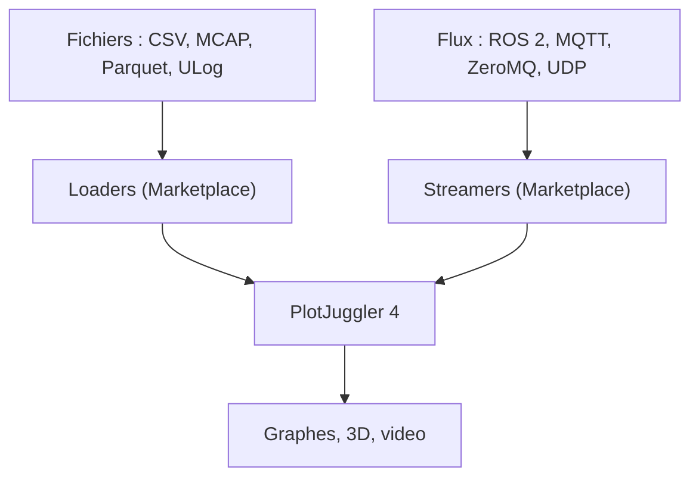

# facontidavide/PlotJuggler

> Application for visualizing time-series and multimodal signals, to compare sensor and robot recordings.

## The problem
Exploring recordings or live sensor streams, aligning them in time and comparing runs calls for throwaway scripts.

## What it actually does
You drag signals into time or XY plots, overlay several recordings, apply filters, derivatives, integrals or FFT, and add transformations in Lua or Python. It also displays images, videos, point clouds and URDF models. Sources range from CSV, MCAP and Parquet to ROS 2, MQTT and ZeroMQ, via a plugin Marketplace.

## How it is wired

Simplified diagram based on the write-up, no diagram provided.

## Trying it
```bash
curl -fsSL https://apt.plotjuggler.io/pj4_install.sh | sudo sh
chmod +x PlotJuggler-*-x86_64.AppImage
./PlotJuggler-*-x86_64.AppImage
```

## Cost and gotchas
Free, MPL-2.0 license. Windows installer, apt repository (Ubuntu 22.04+ and Debian 12+) or AppImage (glibc 2.35 minimum). The install script is run with sudo: read `pj4_install.sh` first.

## What it is not
It is not a statistical analysis or machine learning tool: it visualizes and transforms signals. This repo's README is identical to that of PlotJuggler/PlotJuggler.

## Alternatives
No alternative is cited in the README.

## For you
Worth watching: useful for inspecting live sensor or robotics logs, less relevant for classic tabular data.
