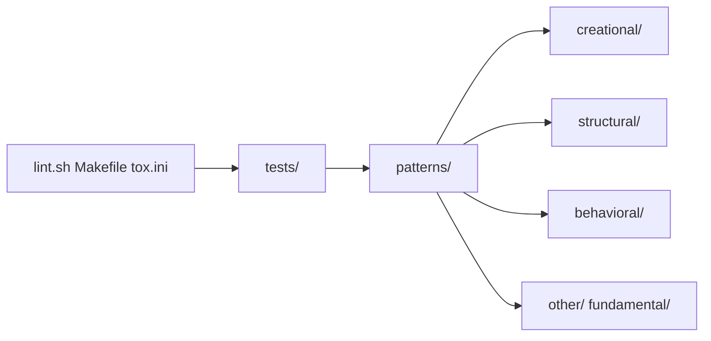

# faif/python-patterns

> Collection of design patterns and idioms in Python, with short examples, for Python developers.

## The problem
Design pattern catalogs are written for Java or C++; in Python some patterns are superfluous and need to be seen as local idioms.

## What it actually does
One Python module per pattern, organized by category: creational (abstract_factory, builder, pool…), structural (adapter, decorator, facade, proxy…), behavioral (observer, strategy, state, command…), testability, fundamentals and others (blackboard, graph_search, hsm). A section on anti-patterns (Singleton, God Object, inheritance abuse) explains why to avoid them. The tests mirror the directory tree.

## How it is wired


## Trying it
```bash
./lint.sh
make lock
```

## Cost and gotchas
Free. License: none declared in the catalog, so reuse of the code is legally unclear. The README insists: every pattern has its trade-offs.

## What it is not
Not a library to import nor an authority: a learning aid. The README reminds you to ask why to choose a pattern rather than how to implement it.

## Alternatives
- No alternative named in the README.

## For you
Adopt as a reading cheat sheet for structuring pipeline Python code, without copying code since the license is not declared.
