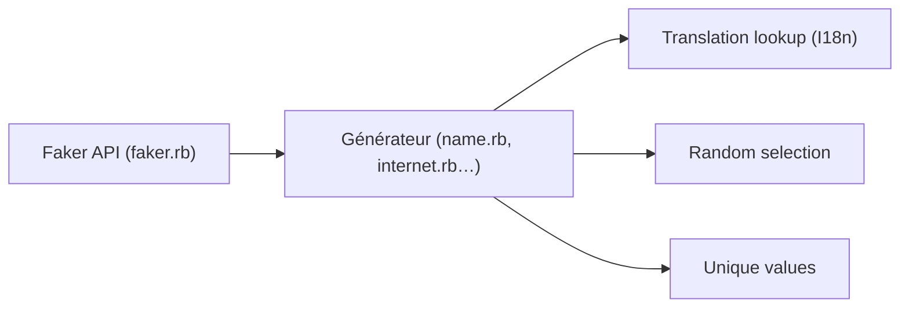

# faker-ruby/faker

> Ruby library that generates realistic fake data for tests, demos and development.

## The problem
Filling a test database by hand with credible names, addresses or emails takes time.

## What it actually does
Ruby gem: a call such as `Faker::Name.name` or `Faker::Internet.email` produces a value drawn from the I18n translation files (over 40 locales). Options: unique values (`unique`), deterministic output via `Faker::Config.random = Random.new(42)`. Varied generators (finance, dates, Lorem, cinema, games).

## How it is wired


## Trying it
```bash
bundle install
```
```ruby
gem 'faker'
require 'faker'
Faker::Name.name
```

## Cost and gotchas
Free. Values may by chance be real data. Without requesting uniqueness, duplicates are possible.

## What it is not
Not a statistical dataset generator nor generative AI. It is Ruby, not Python.

## Alternatives
No alternative named in the README.

## For you
Ignore on the Python side: you will have the equivalent in your ecosystem; useful only if you touch Ruby/Rails.
