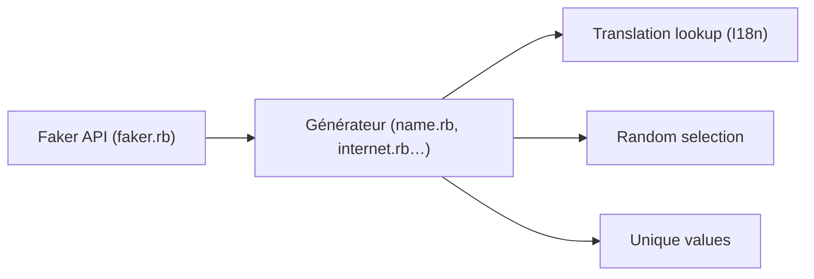

# faker-ruby/faker

> Bibliothèque Ruby qui génère de fausses données réalistes pour tests, démos et développement.

## Le problème
Remplir une base de test à la main avec des noms, adresses ou emails crédibles prend du temps.

## Ce que ça fait vraiment
Gem Ruby : un appel `Faker::Name.name` ou `Faker::Internet.email` produit une valeur tirée des fichiers de traduction I18n (plus de 40 locales). Options : valeurs uniques (`unique`), sortie déterministe via `Faker::Config.random = Random.new(42)`. Générateurs variés (finance, dates, Lorem, cinéma, jeux).

## Comment c'est branché


## Essayer
```bash
bundle install
```
```ruby
gem 'faker'
require 'faker'
Faker::Name.name
```

## Coût et pièges
Gratuit. Les valeurs peuvent par hasard être des données réelles. Sans unicité demandée, des doublons sont possibles.

## Ce que ce n'est pas
Pas un générateur de jeux de données statistiques ni d'IA générative. C'est du Ruby, pas du Python.

## Alternatives
Aucune alternative nommée dans le README.

## Pour toi
À ignorer côté Python : tu auras l'équivalent dans ton écosystème ; utile uniquement si tu touches à du Ruby/Rails.

