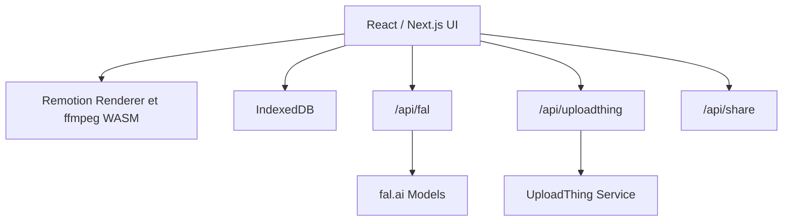

# fal-ai-community/video-starter-kit

> Next.js web application template to assemble AI-generated videos through fal.ai.

## The problem
Wiring video generation models to an in-browser editing interface takes a lot of glue: storage, file upload, rendering, sharing.

## What it actually does
A Next.js application with Remotion and ffmpeg in WebAssembly assembles clips, audio and voice-overs in the browser. Four server routes (download, fal, share, uploadthing) forward calls to fal.ai (Minimax, Hunyuan, LTX) and to UploadThing. Projects are kept in IndexedDB, with no central database. The targeted deployment is Vercel.

## How it is wired


## Trying it
```bash
git clone https://github.com/fal-ai-community/video-starter-kit
cd video-starter-kit
npm install
cp .env.example .env.local
npm run dev
```

## Cost and gotchas
fal.ai and UploadThing accounts are required; video generation is billed per use by fal.ai. The README does not detail the environment variables: read .env.example.

## What it is not
It is not a generation model: all the AI part runs at fal.ai. It is not a ready-to-use hosted service, but a starting point to modify.

## Alternatives
No alternative named in the README.

## For you
Worth watching: useful as a skeleton to prototype AI-driven video editing, but you remain dependent on fal.ai and its billing.
