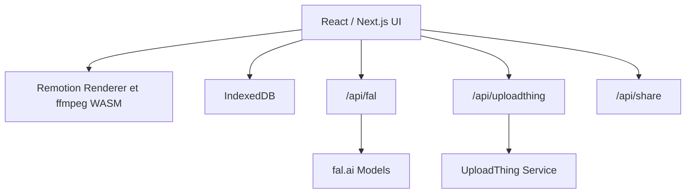

# fal-ai-community/video-starter-kit

> Modèle d'application web Next.js pour assembler des vidéos générées par IA via fal.ai.

## Le problème
Brancher des modèles de génération vidéo à une interface de montage dans le navigateur demande beaucoup de colle : stockage, envoi de fichiers, rendu, partage.

## Ce que ça fait vraiment
Une application Next.js avec Remotion et ffmpeg en WebAssembly assemble des clips, de l'audio et des voix off dans le navigateur. Quatre routes serveur (download, fal, share, uploadthing) transmettent les appels à fal.ai (Minimax, Hunyuan, LTX) et à UploadThing. Les projets sont conservés dans IndexedDB, sans base centrale. Le déploiement visé est Vercel.

## Comment c'est branché


## Essayer
```bash
git clone https://github.com/fal-ai-community/video-starter-kit
cd video-starter-kit
npm install
cp .env.example .env.local
npm run dev
```

## Coût et pièges
Il faut des comptes fal.ai et UploadThing ; la génération vidéo est facturée à l'usage par fal.ai. Le README ne détaille pas les variables d'environnement : lire .env.example.

## Ce que ce n'est pas
Ce n'est pas un modèle de génération : toute la partie IA tourne chez fal.ai. Ce n'est pas un service hébergé prêt à l'emploi, mais un point de départ à modifier.

## Alternatives
Aucune alternative nommée dans le README.

## Pour toi
À surveiller : utile comme squelette pour prototyper un montage vidéo piloté par IA, mais tu restes dépendant de fal.ai et de sa facturation.

