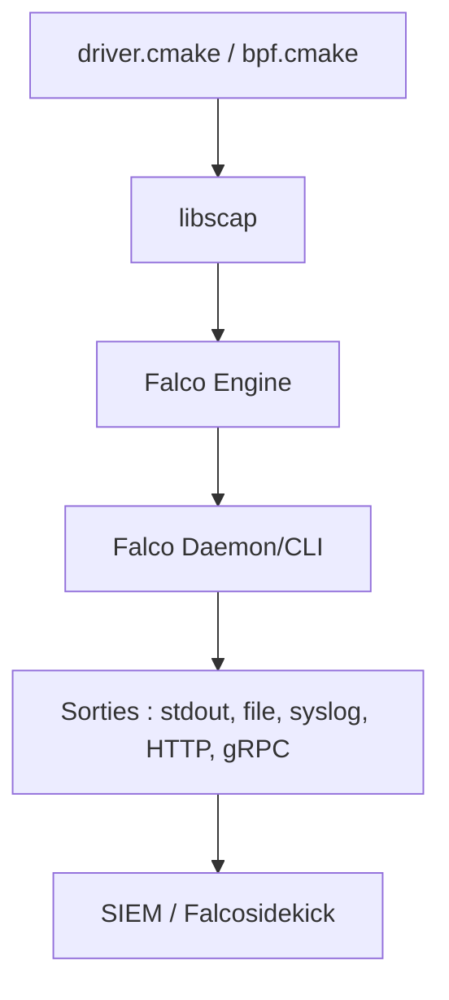

# falcosecurity/falco

> Runtime security agent for Linux and Kubernetes that detects abnormal behavior through syscalls.

## The problem
Without kernel-level monitoring, suspicious activity inside containers goes unnoticed until an incident happens.

## What it actually does
Falco observes kernel events (syscalls) through a kmod driver or a modern eBPF one, enriches them with container and Kubernetes metadata, applies customizable rules and emits alerts. Outputs go to stdout, file, syslog, HTTP or gRPC. Graduated CNCF project, originally created by Sysdig.

## How it is wired


## Trying it
```bash
cmake \
-DUSE_BUNDLED_DEPS=ON \
-DBUILD_DRIVER=ON \
-DBUILD_FALCO_MODERN_BPF=ON \
-DCREATE_TEST_TARGETS=ON \
-DBUILD_FALCO_UNIT_TESTS=ON ..;
make -j$(($nproc-1)) falco_unit_tests;
sudo ./unit_tests/falco_unit_tests;
```
A docker-compose demo (falco, falcosidekick, falcosidekick-ui, redis) is mentioned without a command.

## Cost and gotchas
Free. Requires Linux, root privileges and a kernel driver. Adding plugins depends on glibc.

## What it is not
Not a prevention tool: it detects and alerts. Not a SIEM: analysis happens elsewhere. The README does not document any telemetry; the alert is not retained.

## Alternatives
No alternative named in the README.

## For you
Keep an eye on it: useful if you operate Kubernetes clusters in MLOps and want runtime detection, but outside the core of data / AI.
