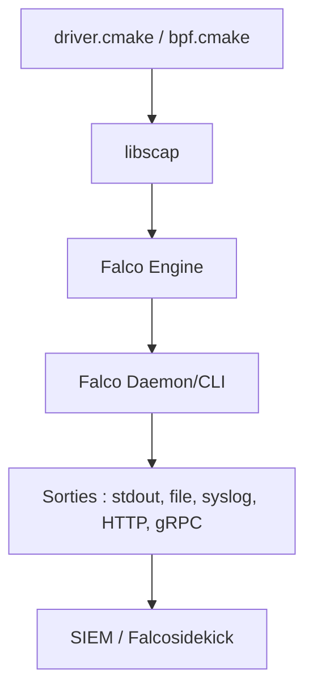

# falcosecurity/falco

> Agent de sécurité runtime pour Linux et Kubernetes, qui détecte les comportements anormaux via les syscalls.

## Le problème
Sans surveillance au niveau noyau, une activité suspecte dans des conteneurs passe inaperçue jusqu'à l'incident.

## Ce que ça fait vraiment
Falco observe les événements du noyau (syscalls) par un driver kmod ou eBPF moderne, les enrichit avec les métadonnées conteneur et Kubernetes, applique des règles personnalisables et émet des alertes. Les sorties vont vers stdout, fichier, syslog, HTTP ou gRPC. Projet CNCF gradué, créé à l'origine par Sysdig.

## Comment c'est branché


## Essayer
```bash
cmake \
-DUSE_BUNDLED_DEPS=ON \
-DBUILD_DRIVER=ON \
-DBUILD_FALCO_MODERN_BPF=ON \
-DCREATE_TEST_TARGETS=ON \
-DBUILD_FALCO_UNIT_TESTS=ON ..;
make -j$(($nproc-1)) falco_unit_tests;
sudo ./unit_tests/falco_unit_tests;
```
Une démo docker-compose (falco, falcosidekick, falcosidekick-ui, redis) est mentionnée sans commande.

## Coût et pièges
Gratuit. Exige Linux, des droits root et un driver noyau. L'ajout de plugins dépend de la glibc.

## Ce que ce n'est pas
Pas un outil de prévention : il détecte et alerte. Pas un SIEM : l'analyse se fait ailleurs. Le README ne documente pas de télémétrie ; l'alerte n'est pas retenue.

## Alternatives
Aucune alternative nommée dans le README.

## Pour toi
Surveiller : utile si tu opères des clusters Kubernetes en MLOps et veux de la détection runtime, mais hors du cœur data / IA.

