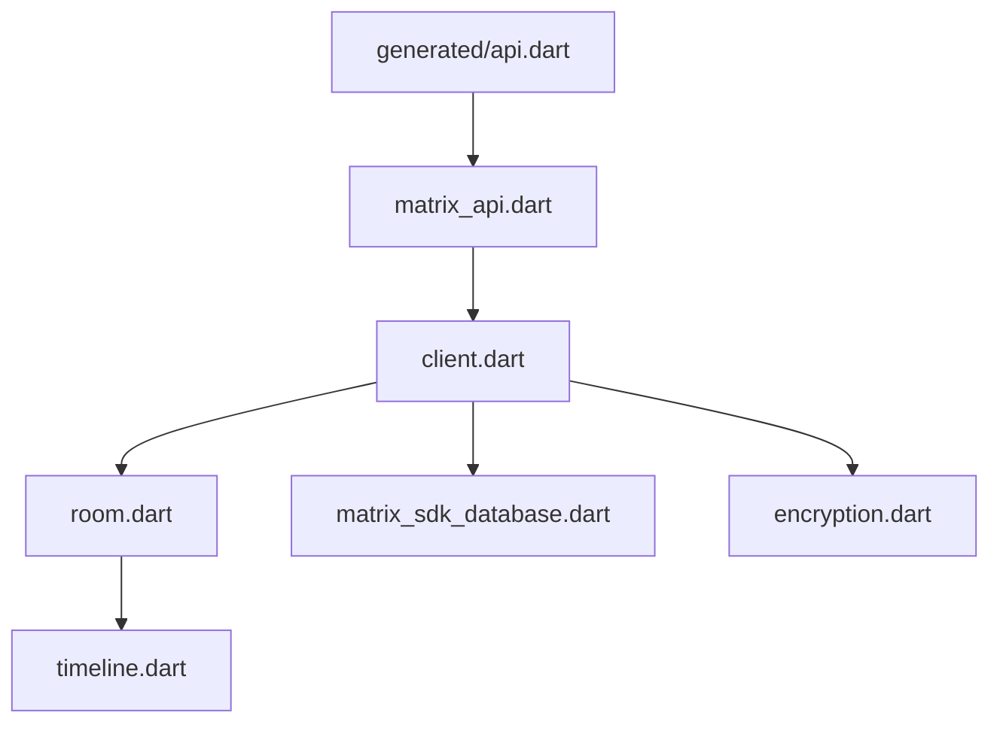

# famedly/matrix-dart-sdk

> Dart SDK for the Matrix protocol, for developers of Flutter or Dart messaging apps.

## The problem
Speaking the Matrix protocol from Dart requires a client, synchronization and end-to-end encryption.

## What it actually does
A client relies on the generated Matrix API to synchronize rooms and events, stored in a local database. An encryption module handles E2EE via Olm and a voip module adds calls. For E2EE, vodozemac must be provided.

## How it is wired


## Trying it
```bash
flutter pub add matrix
# Optional: For end to end encryption:
flutter pub add flutter_vodozemac
```

## Cost and gotchas
Free. AGPL-3.0: a product that embeds it must publish its sources, a blocking point for proprietary use. Encryption requires a native library.

## What it is not
Not a Matrix server, only a client SDK. The README has no usage example; it points to the API documentation.

## Alternatives
No alternative named in the README.

## For you
Ignore: Dart messaging unrelated to data or AI, under a restrictive AGPL license.
