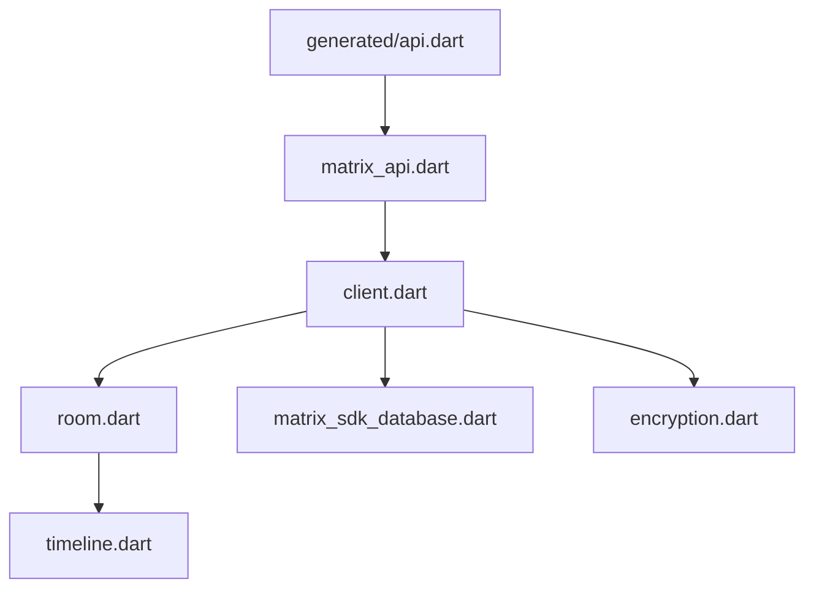

# famedly/matrix-dart-sdk

> SDK Dart pour le protocole Matrix, pour développeurs d'applications de messagerie Flutter ou Dart.

## Le problème
Parler le protocole Matrix depuis Dart demande un client, la synchronisation et le chiffrement de bout en bout.

## Ce que ça fait vraiment
Un client s'appuie sur l'API Matrix générée pour synchroniser salons et événements, stockés dans une base locale. Un module de chiffrement gère l'E2EE via Olm et un module voip ajoute les appels. Pour l'E2EE, vodozemac doit être fourni.

## Comment c'est branché


## Essayer
```bash
flutter pub add matrix
# Optional: For end to end encryption:
flutter pub add flutter_vodozemac
```

## Coût et pièges
Gratuit. AGPL-3.0 : un produit qui l'embarque doit en publier les sources, point bloquant pour un usage propriétaire. Le chiffrement exige une bibliothèque native.

## Ce que ce n'est pas
Pas un serveur Matrix, seulement un client SDK. Le README n'a pas d'exemple d'usage, il renvoie à la documentation d'API.

## Alternatives
Aucune alternative nommée dans le README.

## Pour toi
Ignorer : de la messagerie Dart sans rapport avec les données ou l'IA, sous licence AGPL contraignante.

