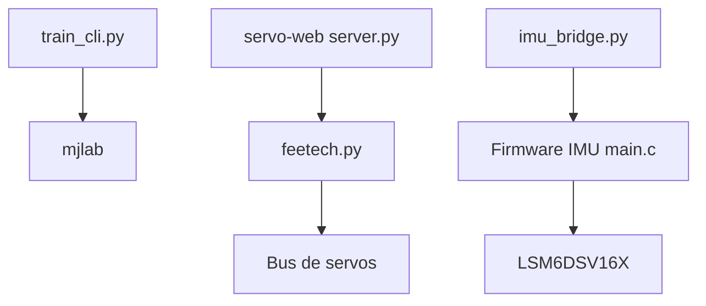

# fanhao375/microduck-replica

> Complete kit to build and drive a replica of the Microduck biped robot, for robotics makers.

## The problem
Rebuilding a small biped robot requires gathering plans, bill of materials, system images, calibration and training into a single guide.

## What it actually does
- CAD plans, print files, bill of materials and assembly tutorials for Feetech HD-1910 or Dynamixel XL330 servos.
- System image and Microduck Studio web interface to configure the network, calibrate and command the robot.
- Reinforcement learning web training platform with ONNX model export.
- Servo test tools and IMU board firmware.

## How it is wired


## Trying it
```bash
# Aucune commande documentée : le parcours passe par le téléchargement d'une image
# système, un flashage de carte SD et l'interface web Microduck Studio.
```

## Cost and gotchas
Hardware to buy (servos, Radxa boards, 3D printing). The image is restricted to personal non-commercial use. Training: GPU, never validated in real conditions for custom policies.

## What it is not
Not standalone software: it is a hardware project. Unrelated to Pollen Robotics and not endorsed by it. The README is in Chinese.

## Alternatives
No alternative named in the README.

## For you
Ignore, unless you have a robotics project: only the reinforcement learning part overlaps with your profile, and it remains to be validated on a real robot.
