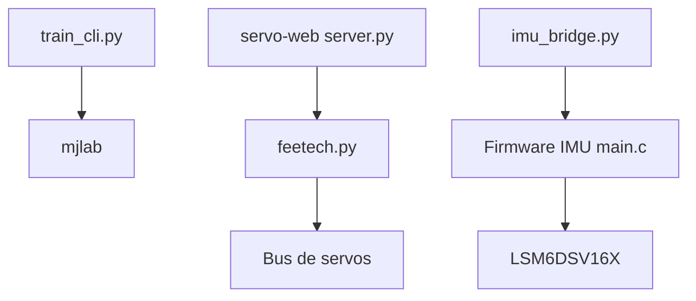

# fanhao375/microduck-replica

> Dossier complet pour construire et piloter une réplique du robot bipède Microduck, pour makers de robotique.

## Le problème
Reconstruire un petit robot bipède exige de réunir plans, nomenclature, images système, calibration et apprentissage dans un seul guide.

## Ce que ça fait vraiment
- Plans CAD, fichiers d'impression, nomenclature et tutoriels d'assemblage pour servos Feetech HD-1910 ou Dynamixel XL330.
- Image système et interface web Microduck Studio pour configurer le réseau, calibrer et commander le robot.
- Plateforme web d'entraînement par renforcement avec export de modèles ONNX.
- Outils de test de servos et firmware de la carte IMU.

## Comment c'est branché


## Essayer
```bash
# Aucune commande documentée : le parcours passe par le téléchargement d'une image
# système, un flashage de carte SD et l'interface web Microduck Studio.
```

## Coût et pièges
Matériel à acheter (servos, cartes Radxa, impression 3D). L'image est réservée à un usage personnel non commercial. Entraînement : GPU, jamais validé en conditions réelles pour les politiques maison.

## Ce que ce n'est pas
Pas un logiciel autonome : c'est un projet matériel. Sans lien avec Pollen Robotics ni approuvé par elle. Le README est en chinois.

## Alternatives
Aucune alternative nommée dans le README.

## Pour toi
À ignorer, sauf projet de robotique : seul le volet entraînement par renforcement croise ton profil, et il reste à valider sur robot réel.

