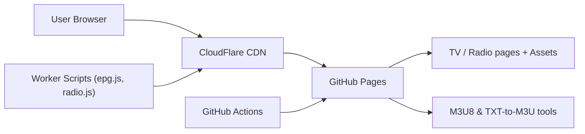

# fanmingming/live

> Library of TV and radio channel logos, with small M3U/EPG tools hosted on GitHub Pages.

## The problem
IPTV players need channel icons and well-formed M3U files, which nobody maintains centrally.

## What it actually does
Serves PNG logos by URL (`/tv/{name}.png`, `/radio/{name}.png`), an EPG guide (`e.xml`) and web tools: m3u8 download, TXT↔M3U conversion, M3U8 player. The repository also contains M3U lists collected from the Internet, with no guarantee of validity. The project says it stores no stream and leaves legal responsibility to users.

## How it is wired


## Trying it
```bash
# Récupérer le fichier exemple mentionné dans le README :
# https://live.fanmingming.cn/tv/m3u/demo.m3u
# puis y remplacer les sources par les vôtres et publier sur GitHub Pages
```

## Cost and gotchas
Free. Depends on domains and a CDN run by one person. The EPG comes from a third-party site whose accuracy is not guaranteed.

## What it is not
It is not a streaming service nor a stream provider. The lists in the `/m3u/` folder are collected from the Internet and serve, says the README, "for testing and study".

## Alternatives
- No alternative named in the README.

## For you
Ignore: IPTV resource unrelated to data or AI, and whose stream lists raise legality questions.
