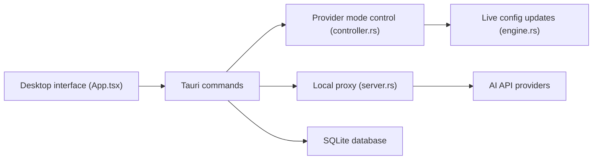

# farion1231/cc-switch

> A desktop application that switches between different API providers and centralizes MCP, skills, and prompts for eleven developers.

## The problem
Each agent (Claude Code, Codex, Gemini CLI…) has its own configuration format. Changing providers or synchronizing MCP and skills requires manually editing JSON, TOML, or YAML files.

## What it actually does
A Tauri 2 application (for Windows, macOS, and Linux) with over 90 presets. The switch only affects the endpoint, key, and model. Local routing (defaulting to 127.0.0.1:15721) converts API formats and enables failover; a merging mode combines models from multiple providers. It also manages MCP, prompts, skills, session reading, usage tracking, and WebDAV/S3 syncing.

## How it is wired


## Trying it
```bash
brew install --cask cc-switch
paru -S cc-switch-bin
CC_SWITCH_GDK_BACKEND=wayland ./CC-Switch-*.AppImage
```

## Cost and gotchas
Free; however, you are responsible for obtaining and maintaining the necessary keys and invoices from suppliers. Using an unofficial client subscription may violate the supplier's terms and conditions (see README). In routing mode, the configuration points to 127.0.0.1 with a fictitious key; this breaks when using WSL2 in NAT.

## What it is not
This is not a headless version: a separate, community-developed command-line interface (CLI) exists for servers. Official vendors do not use local routing (except for OpenAI's Official Codex).

## Alternatives
- CC Switch CLI: Community-developed command-line version.
- opencodex: a source of inspiration for the aggregation mode.

## For you
This is a good option if you manage multiple agents and suppliers: a single platform for managing keys, MCPs, and skills will prevent configuration errors and simplify maintenance, as you only need to monitor one person.
