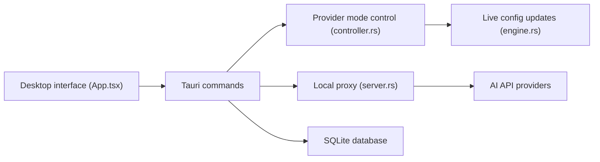

# farion1231/cc-switch

> Application de bureau qui change de fournisseur d'API et centralise MCP, skills et prompts pour onze agents de code.

## Le problème
Chaque agent (Claude Code, Codex, Gemini CLI…) a son format de config ; changer de fournisseur ou synchroniser MCP et skills oblige à éditer JSON, TOML ou YAML à la main.

## Ce que ça fait vraiment
Une app Tauri 2 (Windows, macOS, Linux) avec plus de 90 presets. Le basculement ne remplace que endpoint, clé et modèle. Un routage local (127.0.0.1:15721 par défaut) convertit les formats d'API et fait du failover ; un mode agrégation fusionne des modèles de plusieurs fournisseurs. Elle gère aussi MCP, prompts, skills, lecture de sessions, suivi d'usage et sync WebDAV/S3.

## Comment c'est branché


## Essayer
```bash
brew install --cask cc-switch
paru -S cc-switch-bin
CC_SWITCH_GDK_BACKEND=wayland ./CC-Switch-*.AppImage
```

## Coût et pièges
Gratuit ; les clés et factures des fournisseurs restent à ta charge. Utiliser un abonnement hors client officiel peut violer les conditions du fournisseur (avertissement du README). En mode routage, la config pointe vers 127.0.0.1 avec une clé fictive ; sous WSL2 en NAT cela casse.

## Ce que ce n'est pas
Pas une version headless : une CLI communautaire séparée existe pour les serveurs. Les fournisseurs officiels ne passent pas par le routage local (sauf OpenAI Official de Codex).

## Alternatives
- CC Switch CLI : version terminal communautaire.
- opencodex : source d'inspiration du mode agrégation.

## Pour toi
À adopter si tu jongles entre plusieurs agents et fournisseurs : un seul endroit pour clés, MCP et skills évite les erreurs de config, avec un seul mainteneur à surveiller.

