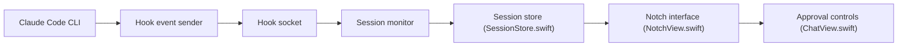

# farouqaldori/claude-island

> macOS application (Vibe Notch) that shows the state of Claude Code sessions in the screen notch.

## The problem
You have to go back to the terminal to find out whether Claude Code is waiting for a permission.

## What it actually does
Hooks installed in `~/.claude/hooks/` send events through a Unix socket; the app tracks several sessions, parses the conversation files, displays the history in Markdown and lets you approve or deny a tool from the notch (via tmux). The hooks are installed automatically on first launch.

## How it is wired


## Trying it
```bash
xcodebuild -scheme ClaudeIsland -configuration Release build
```

## Cost and gotchas
Free; requires macOS 15.6+ and the Claude Code CLI. Anonymous Mixpanel telemetry (launch, version, session start).

## What it is not
Not a cross-platform tool, and not useful outside a Mac with a notch. It modifies your Claude hooks.

## Alternatives
No alternative named in the README.

## For you
Ignore for a data/MLOps profile: a comfort gadget reserved for Macs, with telemetry, and of no value for your pipelines.
