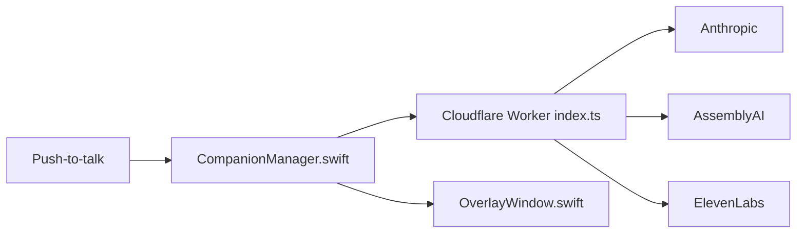

# farzaa/clicky

> macOS AI companion next to the cursor: sees the screen, talks and points at elements.

## The problem
Learning a piece of software forces you to switch between the app and a chat with no screen context.

## What it actually does
Menu bar app: push-to-talk key, AssemblyAI transcription, screenshot sent to Claude via streaming, answer read aloud by ElevenLabs. Claude can insert `[POINT:x,y:label:screenN]` tags to move the cursor. All three APIs go through a Cloudflare Worker that holds the keys. The author resumed development in private (April 2026).

## How it is wired


## Trying it
```bash
cd worker && npm install
npx wrangler secret put ANTHROPIC_API_KEY
npx wrangler secret put ASSEMBLYAI_API_KEY
npx wrangler secret put ELEVENLABS_API_KEY
npx wrangler deploy
open leanring-buddy.xcodeproj
```

## Cost and gotchas
Three paid API keys, a Cloudflare account, macOS 14.2+, Xcode 15+. Microphone, accessibility and screen recording permissions. The code contains `ClickyAnalytics.swift` (probable telemetry).

## What it is not
The README says the open source code is frozen: new features stay private.

## Alternatives
No alternative named in the README.

## For you
Watch: good example of a voice+screen+LLM architecture behind a proxy, but the repo is frozen and API costs apply.
