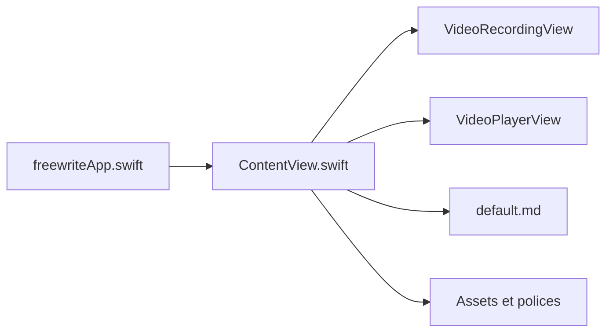

# farzaa/freewrite

> Small open-source Mac app for free-flowing writing, to clone and remix.

## The problem
Writing without censoring yourself calls for a distraction-free tool.

## What it actually does
A README of a few lines: clone, open in Xcode, build. Judging from the code, a local SwiftUI app with no server or database; it bundles a font and a default text, plus video recording and playback views whose role is not described.

## How it is wired

## Trying it
No command: the README describes three steps (clone the repository, open it in Xcode, click Build).

## Cost and gotchas
Xcode and a Mac required. The video access rights (entitlements) are not explained. The maintainer builds the releases himself from PRs.

## What it is not
Not a cross-platform application nor a structured note-taking tool. The description of the architecture is partly inferred from file names.

## Alternatives
No alternative named in the README.

## For you
Ignore: personal writing tool for Mac, unrelated to data or AI, README too thin to go further.
