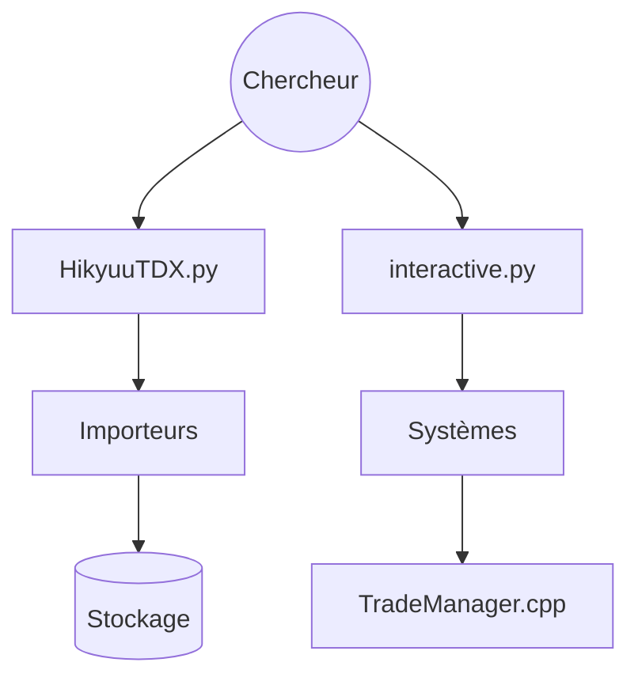

# fasiondog/hikyuu

> C++/Python quantitative research framework where portfolios are nestable strategies, focused on financial correctness.

## The problem
A backtest that "runs" can be wrong: costs, execution delays and dividend adjustments are often left to the user's discretion.

## What it actually does
- C++ core with a Python interface: indicators, trading systems, account manager.
- Explicit financial rules: execution at the next open, detailed costs, adjustments.
- Nestable portfolio in three modes (aggregation, allocation, shared account).
- HDF5, MySQL, ClickHouse or SQLite storage; A-shares data import.

## How it is wired


## Trying it
```bash
pip install hikyuu
HikyuuTDX
importdata
```
```python
from hikyuu.interactive import *
my_tm = crtTM(init_cash=300000)
my_sg = SG_Flex(EMA(CLOSE(), n=5), slow_n=10)
my_mm = MM_FixedCount(1000)
sys = SYS_Simple(tm=my_tm, sg=my_sg, mm=my_mm)
sys.run(sm['sz000001'], Query(-150))
```

## Cost and gotchas
Free. Python 3.10 to 3.13. The importers only cover Chinese A-shares; other markets require a custom driver.

## What it is not
Not an automatic trading or brokerage tool; nor investment advice. Returns are lower than an idealized backtest. End of README truncated.

## Alternatives
No alternative named in the README.

## For you
Worth watching: interesting if you do quantitative research on the Chinese market, less suited to Western markets for lack of ready-made data.
