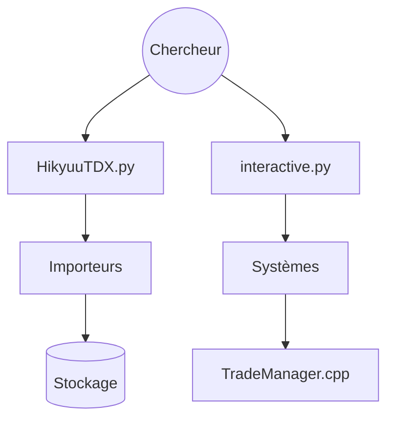

# fasiondog/hikyuu

> Cadre C++/Python de recherche quantitative où les portefeuilles sont des stratégies imbriquables, centré sur la justesse financière.

## Le problème
Un backtest qui « tourne » peut être faux : coûts, délais d'exécution et ajustements de dividendes sont souvent laissés au bon vouloir de l'utilisateur.

## Ce que ça fait vraiment
- Noyau C++ avec interface Python : indicateurs, systèmes de trading, gestionnaire de comptes.
- Règles financières explicites : exécution à l'ouverture suivante, coûts détaillés, ajustements.
- Portefeuille imbriquable en trois modes (agrégation, allocation, compte partagé).
- Stockage HDF5, MySQL, ClickHouse ou SQLite ; import de données A-shares.

## Comment c'est branché


## Essayer
```bash
pip install hikyuu
HikyuuTDX
importdata
```
```python
from hikyuu.interactive import *
my_tm = crtTM(init_cash=300000)
my_sg = SG_Flex(EMA(CLOSE(), n=5), slow_n=10)
my_mm = MM_FixedCount(1000)
sys = SYS_Simple(tm=my_tm, sg=my_sg, mm=my_mm)
sys.run(sm['sz000001'], Query(-150))
```

## Coût et pièges
Gratuit. Python 3.10 à 3.13. Les importeurs ne couvrent que les actions A chinoises ; les autres marchés demandent un pilote maison.

## Ce que ce n'est pas
Pas un outil de trading automatique ni de courtage ; ni un conseil en investissement. Les rendements sont plus bas qu'un backtest idéalisé. Fin du README tronquée.

## Alternatives
Aucune alternative nommée dans le README.

## Pour toi
À surveiller : intéressant si tu fais de la recherche quantitative sur le marché chinois, moins adapté aux marchés occidentaux faute de données prêtes.

