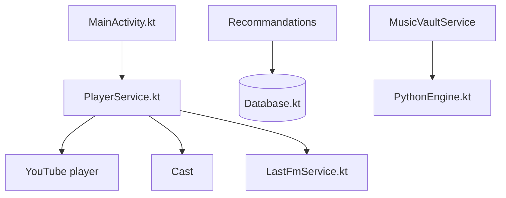

# fast4x/RiPlay

> Free Android music player, online and offline, derived from RiMusic and ViMusic.

## The problem
Listening to your local files and online content in a single app, with no account and no data collection.

## What it actually does
Plays songs, videos, albums, playlists and podcasts, with mixed queues, lyrics, listening statistics, a sleep timer and music recognition. Online content goes through the YouTube Player library in a WebView. Android Auto, cast, Last.fm, Discord presence and database backup are supported.

## How it is wired
Diagram based on the supplied diagram, simplified.

## Trying it
No documented command: download the Full or Base version from the latest release (the Base version has no update check).

## Cost and gotchas
Free. Music recognition goes through AudioTag.info and lyrics through KuGou, LrcLib and SimpMusic. Several features (widget, Android TV) are experimental.

## What it is not
It is not a standalone service: the online player depends on YouTube. The "no collection" promise comes from the README and was not verified here.

## Alternatives
- RiMusic: the project it derives from, by the same author.
- ViMusic: the starting base.

## For you
Ignore: an Android music player, unrelated to your data/AI/MLOps work.
