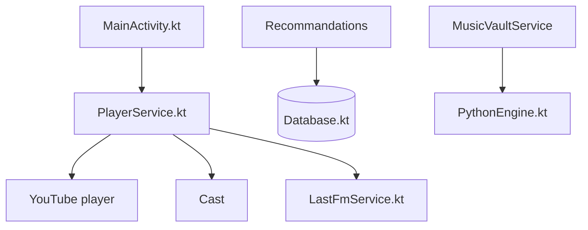

# fast4x/RiPlay

> Lecteur de musique Android libre, en ligne et hors ligne, dérivé de RiMusic et ViMusic.

## Le problème
Écouter ses fichiers locaux et du contenu en ligne dans une seule application, sans compte ni collecte de données.

## Ce que ça fait vraiment
Lit chansons, vidéos, albums, playlists et podcasts, avec files d'attente mixtes, paroles, statistiques d'écoute, minuteur de veille et reconnaissance musicale. Le contenu en ligne passe par la bibliothèque YouTube Player dans une WebView. Android Auto, cast, Last.fm, présence Discord et sauvegarde de base sont prévus.

## Comment c'est branché
Schéma d'après le diagramme fourni, simplifié.

## Essayer
Aucune commande documentée : télécharger la version Full ou Base depuis la dernière release (la version Base n'a pas la vérification de mise à jour).

## Coût et pièges
Gratuit. La reconnaissance musicale passe par AudioTag.info et les paroles par KuGou, LrcLib et SimpMusic. Plusieurs fonctions (widget, Android TV) sont expérimentales.

## Ce que ce n'est pas
Ce n'est pas un service autonome : le lecteur en ligne dépend de YouTube. La promesse « aucune collecte » vient du README, non vérifiée ici.

## Alternatives
- RiMusic : le projet dont il est issu, du même auteur.
- ViMusic : la base de départ.

## Pour toi
À ignorer : lecteur musical Android, étranger à ton travail data/IA/MLOps.

