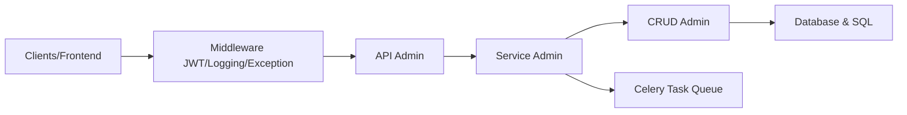

# fastapi-practices/fastapi_best_architecture

> FastAPI backend skeleton in a pseudo three-layer layout (api, service, crud) for enterprise Python projects.

## The problem
A FastAPI project with no imposed structure drifts quickly; teams coming from Java or Django look for a familiar organization.

## What it actually does
The README is very short: it only maps the Java layers to the project's (api = controller, schema = dto, service, crud = dao, model). Based on the code: admin, generator and task modules, JWT and OAuth2 authentication, Casbin access control, Celery asynchronous tasks, plugins (Casbin, notifications), MySQL or PostgreSQL databases, Redis, Docker deployment.

## How it is wired


## Trying it
No command in the README, which points to the official documentation.
```bash
# non documenté dans le README
```

## Cost and gotchas
Free; you need a SQL database, Redis and a Celery worker to get the full benefit. The detailed documentation lives outside the repository.

## What it is not
Not a framework: a project template to clone and adapt. The README describes neither installation nor features: those come from analysis of the code.

## Alternatives
No alternative named in the README.

## For you
Keep an eye on it: a relevant starting point for exposing a model as an API with authentication and background tasks, but read the external documentation before committing, the README proves nothing.
