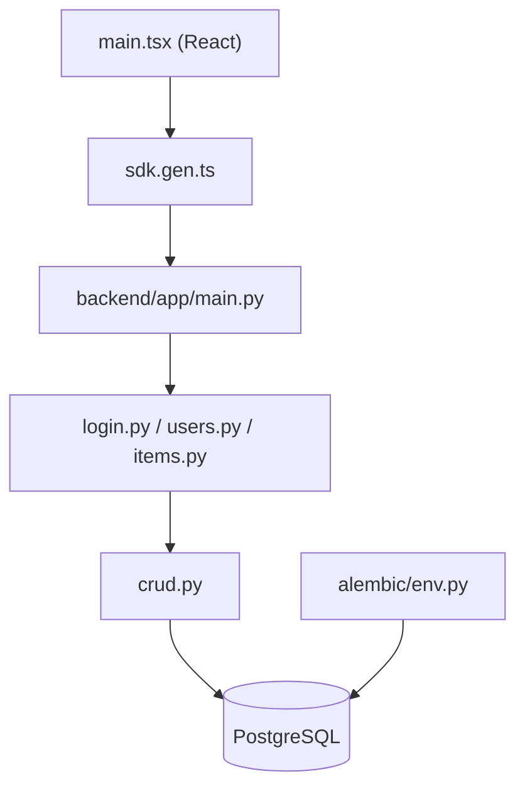

# fastapi/full-stack-fastapi-template

> FastAPI, PostgreSQL, and React project template for building a complete web application with authentication.

## The problem
Manually assembling the API, database, JWT authentication, front-end, email functionality, and CI/CD pipeline with HTTPS takes several days before the first feature is functional.

## What it actually does
Provides a FastAPI/SQLModel backend with Alembic migrations, a React/Vite dashboard with a TypeScript client generated from OpenAPI, JWT login, password recovery, user administration, and CRUD operations. Docker Compose with Traefik, Mailpit (locally), Pytest and Playwright tests, and GitHub Actions workflows.

## How it is wired

## Trying it
The README file does not provide a command; instead, it instructs the user to click on "Use this template" and then follow the instructions in `development.md`, `backend/README.md`, and `frontend/README.md`.

## Cost and gotchas
Free. Target deployment: FastAPI Cloud or self-hosted Docker Compose (you are responsible for the domain and server). A template is copied: upstream updates do not automatically propagate.

## What it is not
Not a framework that can be installed: a codebase to fork and maintain. Only one example template (items).

## Alternatives
No alternative is specified in the README file.

## For you
This should be adopted as a starting point for setting up an API service or an internal tool based on a specific model: with a clean codebase, tests, and deployment already in place.
