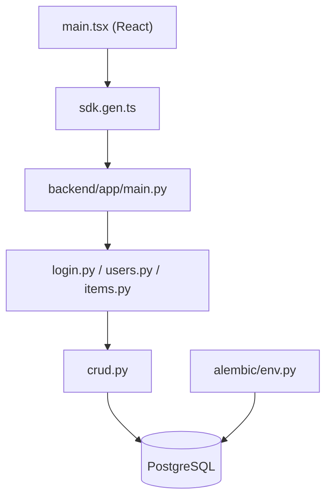

# fastapi/full-stack-fastapi-template

> Gabarit de projet FastAPI, PostgreSQL et React pour démarrer une application web complète avec authentification.

## Le problème
Assembler à la main API, base de données, auth JWT, front, e-mails, CI et HTTPS prend des jours avant la première fonctionnalité.

## Ce que ça fait vraiment
Fournit un backend FastAPI/SQLModel avec migrations Alembic, un dashboard React/Vite avec client TypeScript généré depuis OpenAPI, login JWT, récupération de mot de passe, administration des utilisateurs, items CRUD. Docker Compose avec Traefik, Mailpit en local, tests Pytest et Playwright, workflows GitHub Actions.

## Comment c'est branché

## Essayer
Le README ne donne pas de commande : cliquer sur « Use this template », puis suivre `development.md`, `backend/README.md` et `frontend/README.md`.

## Coût et pièges
Gratuit. Déploiement cible : FastAPI Cloud ou Docker Compose auto-hébergé (domaine et serveur à ta charge). Un gabarit se copie : les mises à jour amont ne se répercutent pas seules.

## Ce que ce n'est pas
Pas un framework installable : une base de code à forker et maintenir. Un seul modèle exemple (items).

## Alternatives
Aucune alternative nommée dans le README.

## Pour toi
À adopter pour amorcer un service d'API ou un outil interne autour d'un modèle : base propre, tests et déploiement déjà posés.

