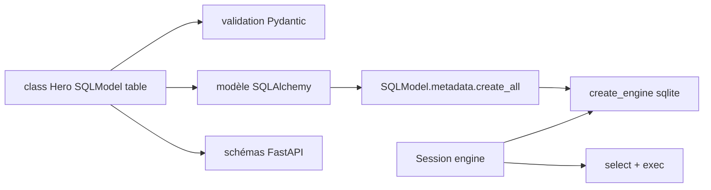

# fastapi/sqlmodel

> Thin layer over Pydantic and SQLAlchemy to describe tables and data models only once.

## The problem
In a FastAPI application, the same entity is written twice: a SQLAlchemy model and a Pydantic schema.
The two drift apart, and every added field must be added in two places.

## What it actually does
A `Hero(SQLModel, table=True)` class is both a SQLAlchemy model and a Pydantic model.
Annotated attributes become columns; `Field(default=None, primary_key=True)` carries the SQL details.
`create_engine`, `Session`, `session.add`, `session.commit` remain the usual SQLAlchemy gestures.
Queries go through `select(Hero).where(...)` then `session.exec(statement).first()`.

## How it is wired


## Trying it
```bash
uv add sqlmodel
```
Then define the class, `engine = create_engine("sqlite:///database.db")`, `SQLModel.metadata.create_all(engine)`,
and write inside a `with Session(engine) as session:`.

## Cost and gotchas
Pydantic and SQLAlchemy are installed with it; their versions and breaking changes become yours.
`pip` works too, but the README requires it inside a virtual environment.

## What it is not
Not a new ORM: it is a thin layer, the power and pitfalls of SQLAlchemy remain underneath.
Not a migration tool: nothing about schema evolution in the README.
Not limited to FastAPI, even though that is the use case that motivated it.

## Alternatives
`SQLAlchemy` alone — if you do not need Pydantic validation on the API side.

## For you
The obvious shortcut whenever you expose SQL data behind FastAPI: one model instead of two.
