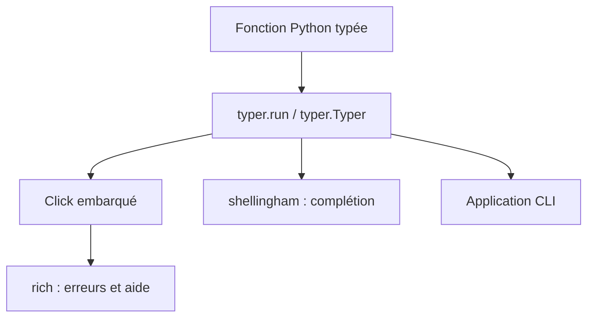

# fastapi/typer

> Python library that turns typed functions into command-line applications, for Python developers.

## The problem
Writing a CLI with argparse or similar takes a lot of repetitive code: options, help, completion, validation.

## What it actually does
You declare the parameters as function arguments with Python types; Typer infers options, arguments, help (`--help`) and shell completion (Bash, Zsh, Fish, PowerShell). It handles subcommands via `typer.Typer()`. The `typer` command can also run a script that does not use Typer by converting it into a CLI. Since 0.26.0, Click's code is bundled instead of being a dependency.

## How it is wired


## Trying it
```bash
uv add typer
typer main.py run
uv run python main.py hello Camila
```

## Cost and gotchas
Free. The README warns that some Click features will not remain available. `typer-slim` no longer exists as a lightweight version.

## What it is not
Not a full application framework: command-line interfaces only.

## Alternatives
Click: the historical base, more explicit; the README notes that Typer has bundled it internally.

## For you
Adopt: ideal for tooling training, evaluation or deployment scripts in Python with very little code.
