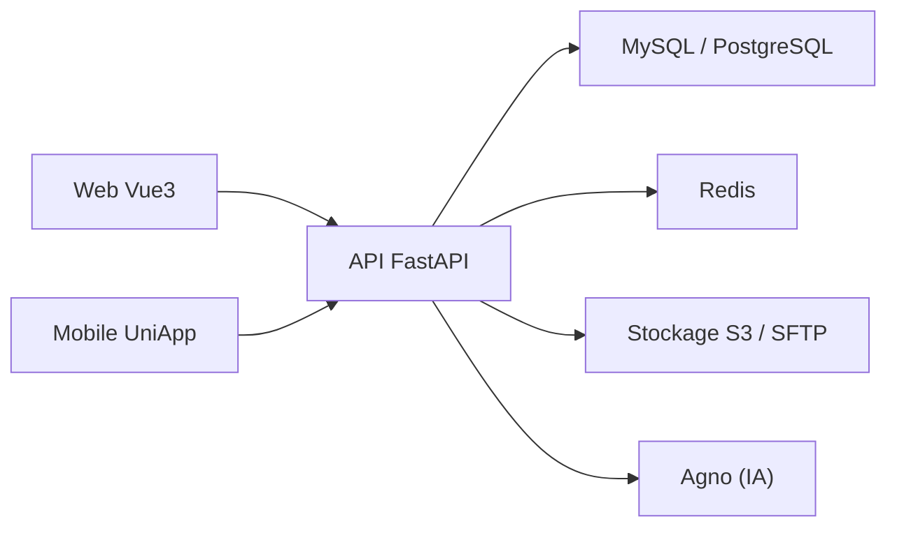

# fastapiadmin/FastapiAdmin

> Full-stack administration platform (FastAPI + Vue3 + UniApp) with RBAC and a code generator, documented in Chinese.

## The problem
Building an admin console with users, permissions, scheduled tasks and mobile takes time from scratch.

## What it actually does
FastAPI backend (Pydantic 2, SQLAlchemy, Alembic) and Vue3/Element Plus web, UniApp mobile. Modules: system, monitoring, logs, scheduled tasks, code generator (table to code), storage (SFTP/S3/OSS/COS/OBS), AI conversation via Agno, internal chat. More than 200 REST routes, MySQL/PostgreSQL/SQLite. `ENABLED_MODULES` removes modules.

## How it is wired


## Trying it
```bash
cd backend && uv sync && uv run main.py run --env=dev
cd ../frontend/web && pnpm install && pnpm run dev
cp docker/.env.example docker/.env
./deploy.sh
```

## Cost and gotchas
SQL database and Redis required. Single-instance deployment (in-memory WebSocket and scheduler). AI/cloud keys go in the `.env` files, never committed. The README is in Chinese.

## What it is not
The chat is text only, with no files or read receipts. Not a data/ML tool: a generic admin base.

## Alternatives
- Django Admin: compared in the README (more limited, synchronous).

## For you
Worth watching: useful if you need to wrap an AI service in an admin console, but outside the data/MLOps core and documented mostly in Chinese.
